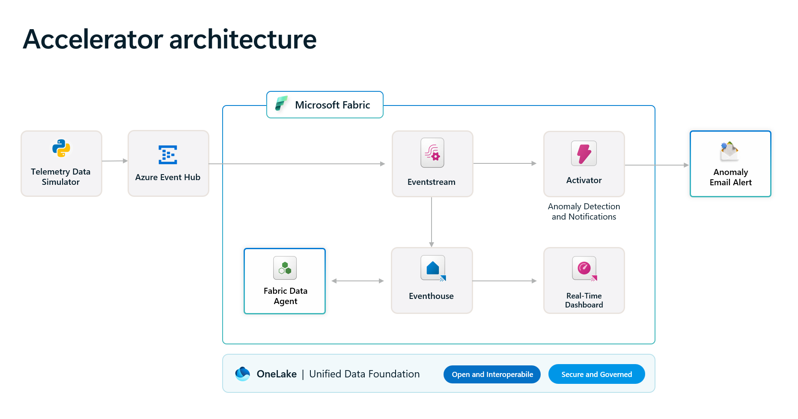
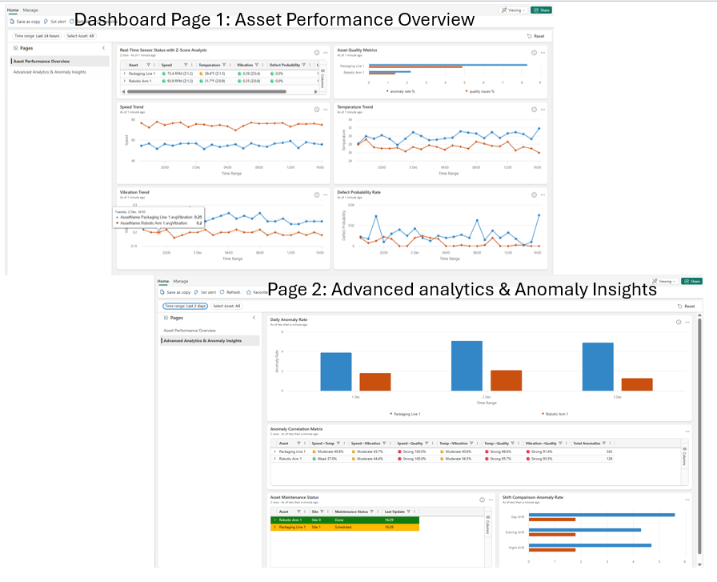

# Real-Time Intelligence Operations Solution Accelerator for Windows 11

### 💻 PowerShell Installer

    

---

This solution accelerator delivers a complete reference architecture and working implementation for real-time intelligence in operations, enabling continuous analysis of live and historical telemetry across monitored assets. It combines an interactive real-time dashboard, automated anomaly detection with alerting, and a Fabric data agent that answers operational questions through a conversational interface without requiring custom query code. The deployment is designed to be adapted to other industries by connecting existing data sources and tailoring dashboards, queries, and alert rules to specific business requirements.

## 🔧 Requirements

- **OS:** Windows 10 / 11
- **Shell:** PowerShell 5.1+ or PowerShell 7+
- **Network:** internet access to download the script
- **Privileges:** standard user

## Features

- **Real-Time Operations Dashboard**: An interactive dashboard surfaces live asset performance, sensor status, quality metrics, and individual telemetry trends, with additional views for daily anomaly rates by asset, maintenance status, and fault correlations. The dashboard is built on reusable KQL queries and can be tailored to your own operational scenarios.

- **Anomaly Detection and Automated Alerts**: Configurable detection rules evaluate streaming telemetry and trigger notifications when anomalies occur, with support for email and channel-based delivery targets. Rules can be adjusted to align with your own thresholds and business requirements.

- **Fabric Data Agent for Conversational Insights**: A conversational interface backed by a customized data agent answers natural-language questions about operational data, enabling business stakeholders to retrieve intelligence without writing query code. Agent instructions can be adapted to reflect your own business goals and data model.

- **Event House and Data Ingestion Pipeline**: Operational telemetry is hosted in an Event House with an accompanying ingestion pipeline. A batch historical data program and a real-time event simulator are included so the solution can be brought up quickly and validated against realistic streaming workloads.

- **Reusable KQL Query Assets**: A library of data analysis and performance metrics KQL code is provided as a starting point, covering common operational calculations and ready to be extended for custom reporting and dashboard tiles.

- **Extensible, Industry-Agnostic Architecture**: The deployment provides a working reference architecture with integrated components, security practices, and configuration defaults. Data sources, queries, detection rules, and agent instructions are all designed for adaptation to other industries and operational domains.

- **Deployment and Demonstration Guidance**: Supporting documentation covers prerequisites, configuration, and a structured walkthrough for demonstrating the deployed solution to stakeholders.

## How it works

The solution accelerator is organized around a streaming telemetry pipeline that moves operational data from ingestion through analysis, visualization, and automated response. Telemetry is produced continuously by the included real-time event simulator, which models asset and sensor behavior, while a companion batch program seeds historical data so that dashboards and queries have context from the first run. The architecture is intentionally decoupled: any custom data source can publish to the event ingestion layer in place of the simulator, allowing the same downstream components to serve other industries or environments without modification.

Ingested events land in a Fabric Eventhouse, where they are persisted and made queryable through KQL. This store acts as the single source of truth for both live and historical analysis, enabling queries that correlate current sensor readings with prior trends. Reusable KQL assets are provided for common data analysis patterns and performance metrics, so operators can extend existing queries rather than author them from scratch. Because the Eventhouse retains both streams, anomaly rules, dashboards, and conversational queries all operate against a consistent dataset.

The real-time operations dashboard renders the Eventhouse data as interactive tiles covering asset status, quality metrics, and individual sensor trends. A second view surfaces derived operational signals such as daily anomaly rates by asset, maintenance status, and fault correlations. Operators can drill into specific sensors and time windows to investigate deviations, and the dashboard updates as new events arrive rather than on a batch refresh cycle.

Anomaly detection is implemented through configurable Activator rules that evaluate incoming data against defined thresholds and patterns. When a rule fires, the Activator dispatches notifications to email recipients, and the same configuration can be directed to a Teams channel for team-based response. Rules are declarative and adjustable, so detection logic can be tuned to specific equipment, operating envelopes, or business priorities without altering the pipeline itself.

A Fabric Data Agent exposes the Eventhouse to natural-language interaction, allowing users to ask operational questions and receive answers derived directly from the data. The agent is configured with instructions supplied by the accelerator, which ground its responses in the solution's schema and business context. This provides business stakeholders with self-service intelligence while preserving the same underlying data path used by dashboards and alerts, keeping conversational results consistent with what operators see elsewhere.

The components share a common deployment topology and reference the same Eventhouse, so replacing the simulator with production data sources, adjusting KQL queries, retuning Activator rules, or refining Data Agent instructions are independent customization points. This separation allows the solution to be adapted incrementally—starting with data ingestion and dashboards, then layering in anomaly detection and conversational analytics—while maintaining a single, coherent operational view.

## Compatibility

The solution accelerator is designed to run on Microsoft Fabric capacity enabled within your organization and deploys into an Azure subscription with the permissions required to create resource groups, resources, and app registrations, and to assign roles at the resource group level. The deployment provisions and integrates the core Fabric components that power the scenario, including Eventhouse and the associated KQL database for telemetry storage, Eventstream for real-time ingestion, Real-Time Intelligence dashboards for visualization, Activator for anomaly detection and alerting, and the Fabric Data Agent for conversational insights.

Compatibility considerations for the solution include:

- **Microsoft Fabric capacity** — Fabric must be enabled for your organization and a capacity must be available in the target region. Workloads including Eventhouse, Eventstream, Real-Time Dashboards, Activator, and the Data Agent depend on Fabric capacity being active and appropriately sized for your expected telemetry volume and query concurrency.
- **Azure subscription and identity** — Deployment requires an Azure subscription with Contributor access at the subscription level and Role Based Access Control permissions at the subscription and/or resource group level. Managed Identity is used for communication between resources, and Azure Key Vault stores connections between components.
- **Data ingestion compatibility** — The architecture accepts telemetry through Azure Event Hub. You can connect your own data sources in place of, or alongside, the included telemetry data simulator, provided the incoming data is mapped to the schema expected by the Eventstream and Eventhouse queries. The batch historical data simulator and real-time event simulator can be customized to align with your industry or company data.
- **Dashboard and query compatibility** — Real-Time Intelligence dashboard tiles are backed by KQL queries and can be updated to reflect your own metrics, assets, and sensor definitions. Activator rules are configurable to match your business thresholds and notification preferences, including email and Teams channel delivery.
- **Data Agent compatibility** — The Fabric Data Agent is configured through instructions delivered with the solution accelerator and operates against the Eventhouse data. Instructions can be updated to align with your own business goals and data insights without requiring programming effort.
- **Extensibility across industries** — While the reference scenario targets manufacturing operations, the architecture is designed to be extended to other industries by connecting your own data sources and customizing dashboards, queries, and alerting rules.

For environment preparation steps and detailed configuration guidance, refer to the deployment documentation included with the solution accelerator.

## 📸 Screenshot

## FAQ

**What does this solution accelerator include out of the box?**
The accelerator ships with a real-time operations dashboard, an anomaly detection pipeline with configurable alerting, a Fabric data agent for conversational querying, a real-time event simulator, and reusable KQL queries for analysis and performance metrics. Together these components form a working end-to-end reference architecture that can be deployed and demonstrated without building the individual pieces from scratch.

**Which data sources does the solution support?**
The default configuration ingests synthetic telemetry generated by the included simulator. The architecture is designed to be extended: you can connect your own event streams or telemetry sources to the ingestion layer and adapt the downstream queries, dashboard tiles, and detection rules accordingly. Historical batch data and live streaming data are both supported.

**How is anomaly detection configured?**
Anomaly detection is driven by rules defined in the Activator component. Rules evaluate incoming telemetry against thresholds and patterns, and trigger notifications when conditions are met. Notification targets, rule logic, and thresholds are all configurable so the detection behavior can be aligned with your operational requirements. The provided rules serve as a starting baseline that can be extended or replaced.

**Can the dashboards and queries be customized?**
Yes. Dashboard tiles are backed by KQL queries that can be modified to reflect your own metrics, asset hierarchies, and reporting needs. The reusable KQL assets included in the accelerator are intended as a starting point, and the provided data analysis and performance metrics querysets can be adapted or extended for custom scenarios.

**What does the data agent do, and what does it require?**
The Fabric data agent provides a conversational interface over the operational data, allowing users to ask questions in natural language and receive answers derived from the underlying telemetry without writing query code. It is configured through instructions supplied with the accelerator, which can be adjusted to match your business terminology and data model. No programming effort is required to use it once deployed.

**What are the prerequisites for deploying the solution?**
Deployment requires an Azure subscription with sufficient permissions to create resource groups, resources, and role assignments, along with Microsoft Fabric capacity enabled for your organization. Specific role and access requirements are detailed in the deployment guidance. Review the prerequisites before starting a deployment to avoid configuration issues.

**How can the solution be adapted to industries beyond manufacturing?**
The core pattern — ingest telemetry, store and query it, visualize it, detect anomalies, and notify — is industry-agnostic. Adaptation typically involves customizing the data simulator or connecting real sources, updating KQL queries for your domain metrics, adjusting Activator rules to your operational thresholds, and revising the data agent instructions to reflect your business context.

**What is the recommended way to explore and demonstrate the solution?**
After a successful deployment, follow the demonstrator guidance to walk through the dashboard, anomaly notifications, and data agent interactions in a structured sequence. This provides a repeatable way to show the solution's capabilities to stakeholders and to validate that each component is functioning as expected.

**How is telemetry data stored and queried?**
Telemetry is hosted in a Fabric eventhouse, which supports high-volume streaming ingestion and low-latency analytical queries over the stored data. The included KQL querysets demonstrate common analytical patterns and can be used as templates for building additional queries against the same data.

**What should be considered before running the solution in production?**
The included data is synthetic and intended for demonstration and evaluation. Before production use, review security configuration such as identity-based access and secret management, validate scaling and capacity settings against your workload, confirm that alerting targets and thresholds match operational expectations, and assess costs for the selected capacity and service tiers.

**Where can I find more detailed guidance?**
Component-level documentation accompanies the accelerator, covering data ingestion, the event simulator, the dashboard, the data agent, Activator rules, KQL assets, and deployment. These guides provide the configuration detail needed to extend and operate each part of the solution.

## Disclaimer

This solution accelerator is provided as a reference implementation to demonstrate architecture patterns and working capabilities for real-time intelligence in operations. It is intended for evaluation, development, and adaptation purposes and is not designed or intended for production use without additional review, testing, and hardening appropriate to your specific environment and requirements.

The solution accelerator is supplied on an "as-is" basis. Features including the real-time dashboard, anomaly detection rules, and Fabric data agent configuration are provided as illustrative implementations and may require modification to meet your operational, regulatory, or security standards. You are responsible for validating all components, data flows, queries, alerting rules, and integrations before relying on them in any live operational scenario.

Telemetry data used by the solution accelerator is synthetic and generated for demonstration purposes only. It does not represent real assets, measurements, or operational conditions and must not be used to inform production decisions. Any dashboards, anomaly thresholds, Activator rules, or data agent instructions included in this accelerator are starting points that should be reviewed and tailored to your own data sources, business logic, and industry context.

You are responsible for the costs incurred by deploying and running the Azure and Microsoft Fabric resources referenced by this solution accelerator, including compute, storage, capacity, and any associated services. Resource configurations, SKUs, and scaling choices affect total consumption and should be evaluated against your own usage and budget.

You are also responsible for ensuring that your use of this solution accelerator complies with all applicable laws, regulations, and organizational policies, including those governing data residency, privacy, access control, and audit. Security controls such as managed identity, secret management, and network isolation should be reviewed and extended as needed for your deployment.

Nothing in this disclaimer grants any license or right to use Microsoft products or services beyond the terms that govern them, and this accelerator does not supersede, amend, or modify any applicable product terms. Microsoft makes no warranties, express or implied, regarding the suitability, reliability, or completeness of this solution accelerator for any particular purpose.

## License

This solution accelerator is released under the MIT License. The license permits use, reproduction, modification, distribution, sublicensing, and sale of the software, subject to inclusion of the original copyright notice and permission notice in all copies or substantial portions of the software. The software is provided "as is", without warranty of any kind, express or implied, including but not limited to the warranties of merchantability, fitness for a particular purpose, and noninfringement.

The license applies solely to the source code and configuration assets contained within this solution accelerator. It does not extend to any Microsoft products or services referenced by, integrated with, or consumed by the accelerator, including Microsoft Fabric, Azure services, or any associated product terms. Use of those products and services remains governed by the separate terms under which they are licensed to you, and nothing in this license supersedes, amends, or modifies those terms.

Where the accelerator incorporates components or code used in or derived from Microsoft products or services, your use of those components is conditioned on your continued compliance with the applicable product terms. You are responsible for ensuring that your deployment, customization, and distribution of the accelerator conform to all relevant terms, as well as to any third-party dependency licenses introduced through your own modifications.

Redistribution of modified versions must preserve the original license and copyright notice and clearly identify any changes made. The accelerator is intended as a reference implementation and architectural starting point; you assume responsibility for validating its behavior, security posture, and regulatory suitability for your operational environment.

THE SOFTWARE IS PROVIDED "AS IS", WITHOUT WARRANTY OF ANY KIND, EXPRESS OR IMPLIED, INCLUDING BUT NOT LIMITED TO THE WARRANTIES OF MERCHANTABILITY, FITNESS FOR A PARTICULAR PURPOSE AND NONINFRINGEMENT. IN NO EVENT SHALL THE AUTHORS OR COPYRIGHT HOLDERS BE LIABLE FOR ANY CLAIM, DAMAGES, OR OTHER LIABILITY, WHETHER IN AN ACTION OF CONTRACT, TORT, OR OTHERWISE, ARISING FROM, OUT OF, OR IN CONNECTION WITH THE SOFTWARE OR THE USE OR OTHER DEALINGS IN THE SOFTWARE.