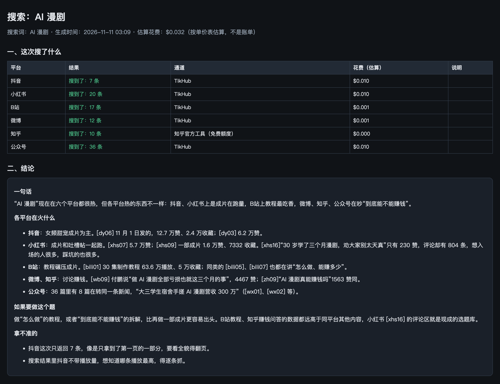

# SourceBoard（信源看板）

让你电脑上的 Agent（Claude Code、Codex、Kimi 等）搜得到、抓得回各个内容平台的数据，并且每次搜完自动摆成一张网页看板。

现在的 Agent 很能干，但它自己打不开抖音、小红书、公众号这些平台。你让它“看看这个题目各平台都有谁做过”，它多半只能翻出几篇普通网页。SourceBoard 把我自己每天在用的这套取数办法整理出来，装好之后，Agent 用一条命令就能把平台里的帖子、视频信息、评论拿回来，再整理成一页给你看。

[English summary](README.en.md)

## 先说清楚：能做什么、要花什么钱、要配什么

### 能做什么

| 能力 | 平台 | 拿到什么 |
|---|---|---|
| 按关键词搜 | 10 个：抖音、小红书、B站、微博、知乎、公众号、YouTube、Reddit、TikTok、X | 作品或帖子列表、作者、互动数、链接、封面 |
| 给链接抓单条 | 20 个平台加普通网页：上面 10 个，加视频号、Instagram、Threads、LinkedIn、Bluesky、Telegram、Medium、Substack、Pinterest、Facebook | 正文、作者、点赞评论转发收藏、第一页评论、现成字幕、图片和视频地址；部分平台有播放量 |
| 看账号主页 | 7 个：抖音、小红书、B站、TikTok、Instagram、YouTube、X | 昵称、简介、粉丝、关注、获赞、作品数、最近一页作品 |
| 出看板 | 以上任何一次搜索或抓取 | 一张本机网页：这次搜了什么、哪里没搜到、Agent 的结论、可排序筛选的资料卡片 |

每个平台具体能拿到哪些字段、哪些拿不到，见 [docs/platforms.md](docs/platforms.md)。

### 要花什么钱

SourceBoard 本身免费、开源。但平台数据大部分来自 [TikHub](https://tikhub.io)，这是一个按次收费的数据接口，**需要你自己注册、充值**。我和 TikHub 没有合作关系，下面的链接也不是邀请链接。

| 做什么 | 大概花费（美元） |
|---|---|
| 搜一次抖音、小红书或公众号 | $0.01 |
| 搜一次 B站、微博、Reddit、TikTok、X | $0.001 |
| 搜一次 YouTube | $0.002 |
| 搜一次知乎 | 装了知乎官方工具就免费，否则 $0.001 |
| 十个平台各搜一遍 | 约 $0.04 |
| 抓一条抖音（含播放量和第一页评论） | 约 $0.002 |
| 抓一条小红书（含第一页评论） | 约 $0.02 |
| 抓一条 B站、微博、知乎、X、Reddit | $0.001–0.002 |
| 抓一条公众号文章 | 免费路线成功就是 0，失败转 TikHub 是 $0.01 |

这些是我自己使用中记录的单价（2026 年 10–11 月），TikHub 可能调价，以它的官方价格为准。充几美元可以用很久。

为了少花钱，SourceBoard 做了这些事：

- **能免费的先走免费。** 抖音、公众号、X、Reddit、TikTok、Instagram、Threads、LinkedIn、Bluesky、Telegram、Medium、Substack 的正文先读平台自己的公开页面，读不到才转 TikHub。小红书和 B站的免费路线不稳定，默认直接走 TikHub。
- **YouTube 走官方接口的免费额度。** 配一个免费的 YouTube 钥匙后，视频详情、频道资料、上传列表都不花钱。
- **知乎走官方工具。** 装了知乎官方命令行工具，知乎搜索就不走 TikHub。它有自己的免费额度。
- **同一个请求 24 小时内不重复扣费。** 反复查同一批对标时最省。
- **默认少调。** 批量抓取默认不抓评论；小红书的阅读量和曝光量默认不查（每条多花约 $0.02，要的时候加 `--xhs-reads`）；抖音播放量两条合成一次查。
- **每日预算上限。** 安装时设一个数（默认 $1），估算花费到了就不再发起付费调用。
- **先看价再花钱。** `--plan` 只显示会花多少，不联网。
- **完全不花钱模式。** 加 `--no-paid`，一次 TikHub 都不调，拿不到的如实标出来。

### 要配置什么

| 项目 | 必须吗 | 说明 |
|---|---|---|
| TikHub 钥匙 | **必须，第一步就配** | 没有它，搜索用不了，只有少数平台能免费抓单条 |
| Python 3.9 以上 | 必须 | macOS 和大多数 Linux 自带。不需要 pip 装任何东西 |
| YouTube 官方钥匙 | 可选 | 免费。配了之后 YouTube 详情和频道主页不花钱 |
| [知乎官方工具](https://developer.zhihu.com/) | 可选 | 有免费额度。配了之后知乎搜索不走 TikHub |
| yt-dlp | 可选 | YouTube、TikTok、Instagram、Facebook 的免费路线和现成字幕要用 |
| ffmpeg | 可选 | 只有下载 B站视频时才用 |

系统：macOS 和 Linux。Windows 没有验证过。

## 安装：把这个仓库的链接发给你的 Agent

你不用自己复制命令。把下面这句话发给你电脑上的 Agent：

> 安装这个项目并带我完成配置：https://github.com/aaronyi97/sourceboard 。严格按仓库根目录的 AGENT_INSTALL.md 一步步来，每一步告诉我现在在做什么、需要我做什么。

Agent 会按 [AGENT_INSTALL.md](AGENT_INSTALL.md) 带着你走完 7 步：先把上面这些话跟你说清楚，装好程序，**带你注册 TikHub、充值、把钥匙填进本机**，实测钥匙能用，问你常搜哪些平台和每天的预算，再用你自己的题目跑第一次搜索、打开第一张看板。

钥匙由你自己在终端里粘贴，输入时不显示，只存在你电脑上的 `~/.config/sourceboard/config.env`（只有你能读）。不要把钥匙发到对话里。

想自己装也可以：

```sh
git clone https://github.com/aaronyi97/sourceboard.git ~/.sourceboard
cd ~/.sourceboard && ./install.sh
sourceboard setup        # 说明 → 粘贴 TikHub 钥匙 → 设预算 → 选常用平台 → 实测
```

## 怎么用

装好之后直接跟 Agent 说人话就行，比如“搜一下‘AI 视频 选题’在抖音、小红书、B站都有谁做过，出看板”。它会调用下面这些命令：

```sh
# 先看会花多少，不联网
sourceboard search "AI 视频 选题" -p 抖音,小红书,B站 --plan

# 搜索并打开看板
sourceboard search "AI 视频 选题" -p 抖音,小红书,B站 --open

# 给链接或整段分享文案，抓回正文、数据、评论
sourceboard grab 'https://www.douyin.com/video/…' --open

# 账号主页也是丢链接
sourceboard grab 'https://www.xiaohongshu.com/user/profile/…' --open

# 批量：一行一个链接
sourceboard grab --input-file 链接清单.txt --out ~/SourceBoard/对标库 --open

# Agent 读完资料写了结论，补进看板第二层
sourceboard board ~/SourceBoard/searches/某次搜索 --conclusion 结论.md --open

# 余额和花费
sourceboard account
sourceboard usage --by day --since 7d
```

`search` 的常用参数：`--sort hot|new`（按热度或最新，只对支持的平台生效）、`--page 2`（翻页，每页再收一次钱）、`--no-paid`。
`grab` 的常用参数：`--no-comments`、`--comment-pages 3`、`--xhs-reads`、`--with-media`（下载图片和视频，默认只存地址）、`--no-paid`、`--resume`（批量断了接着跑）。每个子命令加 `--help` 看全部。

## 看板长什么样

每次搜索或抓取都会在结果目录里生成一个 `board.html`，暗色、单个文件、双击就能看。一页三层：




1. **这次搜了什么。** 每个平台搜到几条、走的哪条通道、花了多少。没搜到的平台排在最前面，写明原因。接口报错不等于“网上没有”，所以失败不会被藏起来。
2. **结论。** Agent 读完资料后写的结论和依据。
3. **资料卡片。** 封面、标题、作者、播放点赞评论、原链接。可以按平台筛选、按任意数据排序、在标题和正文里找词。每张卡可以点“留”或“不要”、写备注，最后点底部“生成回复”，页面把你的选择汇总成一段文字，贴回对话，Agent 就能接着处理你留下的那几条。

没拿到的数据留空，不填 0。封面用的是平台的网络地址，过几天可能失效。

## 做不到的事

- 拿不到私密内容、已删除内容、付费内容，也拿不到任何账号的后台数据。
- 公众号的阅读量拿不到。小红书的阅读和曝光要手动开，而且小博主经常没有。
- Instagram、Threads、LinkedIn 等只能给链接抓，不能按关键词搜。
- 搜索结果里抖音的播放量不可靠（常年是 0），要播放量请对具体作品用 `grab`。
- 视频号只拿正文、作者和互动数，不下载视频。
- 不做语音转文字。视频有现成字幕时会带回来。
- 平台和 TikHub 的接口会变。某个平台突然搜不到时，看板和命令输出会明说是哪里坏了。
- 不保证每个平台每次都返回完整结果。

## 安全边界

- 只读。不登录任何平台账号，不发布、不点赞、不评论、不私信。
- 不读浏览器的 Cookie 和登录状态，不碰钥匙串。
- TikHub 钥匙只会发给 `api.tikhub.io` 和 `api.tikhub.dev` 这两个官方地址，程序里写死了检查。
- 抓回来的内容存在你自己电脑上（默认 `~/SourceBoard`），不上传。
- 抓回来的是别人的公开内容。拿来研究和找选题没问题；转载、搬运、商用之前，请自己确认有没有权利。下载图片和视频默认关闭，要手动加开关。

## 数据放在哪

```
~/.config/sourceboard/config.env   钥匙和设置（权限 600）
~/SourceBoard/
  searches/   每次搜索一个目录：results.json、board.html、raw/
  runs/       每次抓取一个目录：content.md（给人看）、meta.json（给 Agent 读）、raw/、board.html
  tikhub/     花费账本 usage.jsonl 和缓存
  incidents/  渠道出过的问题
```

两个位置都能改：环境变量 `SOURCEBOARD_CONFIG_DIR`、`SOURCEBOARD_HOME`，或 `sourceboard setup --home 目录`。

## 给想自己做看板的人

`sourceboard board 文件.json` 可以把任何符合下面格式的数据做成同样的看板，不限于本工具抓回来的：

```json
{
  "title": "看板标题",
  "query": "搜索词（可省）",
  "conclusion_md": "结论，Markdown（可省）",
  "sources": [{"platform": "douyin", "name": "抖音", "status": "success", "count": 20, "channel": "TikHub", "cost_usd": 0.01, "note": ""}],
  "items": [{"platform": "douyin", "title": "标题", "author": "作者", "url": "https://…", "published_at": "2026-11-01T08:00:00+00:00",
             "cover": "https://…", "text": "正文或摘要", "stats": {"likes": 123, "comments": 4}}]
}
```

`status` 用这七个词：`success` 搜到了、`true_zero` 正常但没有结果、`index_partial` 只拿到一部分、`not_attempted` 没有去取、`auth_failed` 钥匙或余额有问题、`rate_limited` 被限流、`connector_failed` 接口出错。

## 测试

```sh
python3 -B tests/test_offline.py     # 不联网、不花钱、不需要钥匙
```

## 来源和许可

- 本项目代码：Apache-2.0，见 [LICENSE](LICENSE)。
- 13 个平台的免费抓取方法改编自 OmniScraper（MIT，Copyright 2026 BeatAPI），见 [LICENSE-OmniScraper](LICENSE-OmniScraper) 和 [THIRD_PARTY.md](THIRD_PARTY.md)。
- TikHub、知乎官方工具、yt-dlp、ffmpeg 都是外部服务或程序，本仓库不带它们的代码和安装包，由你自己安装和授权。
- 本项目和 TikHub、各内容平台都没有关联，也没有得到它们的背书。使用时请遵守各平台的规则和你所在地的法律。

相关项目：[Agent Search Kit](https://github.com/aaronyi97/agent-search-kit) 解决的是“让 Agent 知道去哪搜”，SourceBoard 解决的是“把数据真的拿回来，并摆出来给人看”。
